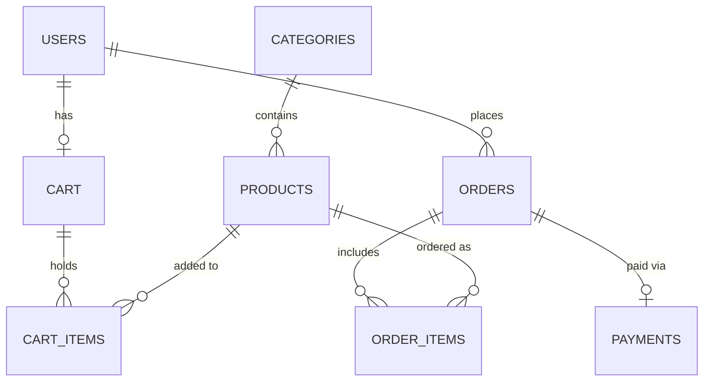

# Online Grocery Shopping and Management System

> **DBMS College Mini-Project Documentation**  
> **Degree / Course:** B.Tech Information Technology (IT) / Computer Science (CSE)  
> **Subject:** Database Management Systems (DBMS)

---

## 1. Project Title
**Online Grocery Shopping and Management System**

---

## 2. Introduction
The **Online Grocery Shopping and Management System** is a web-based database project created to help customers browse and purchase groceries online while allowing store administrators to manage products, categories, stock, and customer orders. It connects a simple frontend (HTML, CSS, JavaScript) with a Node.js/Express backend and a MySQL relational database.

---

## 3. Problem Statement
In traditional physical grocery stores, managing item inventory and customer billing manually on paper or spreadsheets leads to errors, stock miscalculations, lost sales records, and slow customer checkout. This mini-project solves these issues by storing all data in a central relational database, providing real-time stock updates, automated order processing, and clear administrative tracking.

---

## 4. Objectives
* Build an easy-to-use grocery shopping web interface for customers.
* Design a structured MySQL relational database normalized up to 3rd Normal Form (3NF).
* Implement multi-role authentication distinguishing **Customer** and **Admin** users.
* Demonstrate core DBMS concepts such as Primary Keys, Foreign Keys, Referential Integrity, and CRUD operations.
* Use database transactions during checkout to ensure atomic operations (stock deduction, order creation, cart clearing).
* Provide an admin dashboard with key DBMS queries for viva demonstration.

---

## 5. Scope
This project focuses on core relational database concepts for academic evaluation. To keep the code clear, transparent, and easy to explain during a B.Tech DBMS viva examination, advanced commercial features like third-party payment gateways (Razorpay/Stripe), SMS OTP verification, live map GPS tracking, and AI recommendation engines are excluded.

---

## 6. Features

### Customer Features
1. **User Signup & Login:** Session-based authentication for customers.
2. **Product Catalog:** View grocery items organized by categories.
3. **Search & Filter:** Search products by name/description and filter by category.
4. **Shopping Cart:** Add items, update quantities with live stock checks, and remove items.
5. **Checkout & Payment Option:** Specify delivery address and choose Cash on Delivery (COD) or UPI.
6. **Order History:** View placed orders with line-item details and real-time order status.

### Admin Features
1. **Admin Dashboard:** View summary counts of total products, customers, orders, and total revenue.
2. **Product Management:** Add new items, update price/stock levels, and delete products.
3. **Category Management:** Create product categories.
4. **Order Management:** View all customer orders and update status (Pending, Confirmed, Delivered, Cancelled).
5. **DBMS Viva Queries:** View live SQL aggregate queries on the dashboard.

---

## 7. Technology Used

| Component | Technology | Description |
| :--- | :--- | :--- |
| **Frontend** | HTML5, CSS3, JavaScript | Clean student web UI using ES6 `async/await` Fetch API |
| **Backend** | Node.js, Express.js | Server routing and RESTful API endpoints |
| **Database** | MySQL 8.0+ | Relational Database Management System |
| **Authentication** | `express-session` | Server-side session management |
| **Database Connector** | `mysql2` | Promise-based Node.js MySQL driver |

---

## 8. Functional Requirements
1. A customer must be logged in to manage a cart and place an order.
2. Order quantity cannot exceed available product stock.
3. Product price and stock values must be non-negative ($\ge 0$).
4. Ordering products automatically reduces product stock in the database.
5. Cart items are automatically cleared after successful order placement.
6. If any step of checkout fails, the database transaction is rolled back completely.

---

## 9. Modules
1. **Authentication Module (`backend/routes/auth.js`):** User registration, login verification, session creation, and logout.
2. **Product & Category Module (`backend/routes/products.js`):** Category listing and product CRUD operations (Search, Filter, Add, Edit, Delete).
3. **Cart Module (`backend/routes/cart.js`):** Customer cart management, quantity updating, unique item constraint enforcement, and removal.
4. **Order Module (`backend/routes/orders.js`):** Transactional checkout logic, order item insertion, stock deduction, and order status updates.
5. **Admin Module (`backend/routes/admin.js`):** Dashboard counters and important DBMS SQL queries execution.

---

## 10. Database Tables

The database consists of 8 tables:

1. **`users`**: Stores account details and role ('customer' or 'admin').
2. **`categories`**: Stores product category names.
3. **`products`**: Stores grocery items, prices, stock levels, and units.
4. **`cart`**: Stores active shopping cart assigned to each user.
5. **`cart_items`**: Stores items added into a cart (`UNIQUE(cart_id, product_id)`).
6. **`orders`**: Stores placed customer orders and total amount.
7. **`order_items`**: Stores individual line items for placed orders.
8. **`payments`**: Stores payment method and status for orders.

---

## 11. Primary Keys

| Table | Primary Key | Description |
| :--- | :--- | :--- |
| `users` | `user_id` | Uniquely identifies each user |
| `categories` | `category_id` | Uniquely identifies each category |
| `products` | `product_id` | Uniquely identifies each product |
| `cart` | `cart_id` | Uniquely identifies each customer cart |
| `cart_items` | `cart_item_id` | Uniquely identifies each cart line item |
| `orders` | `order_id` | Uniquely identifies each customer order |
| `order_items` | `order_item_id` | Uniquely identifies each order line item |
| `payments` | `payment_id` | Uniquely identifies each payment record |

---

## 12. Foreign Keys

| Table | Foreign Key | References Table (Column) | On Delete Constraint |
| :--- | :--- | :--- | :--- |
| `products` | `category_id` | `categories(category_id)` | `CASCADE` |
| `cart` | `user_id` | `users(user_id)` | `CASCADE` |
| `cart_items` | `cart_id` | `cart(cart_id)` | `CASCADE` |
| `cart_items` | `product_id` | `products(product_id)` | `CASCADE` |
| `orders` | `user_id` | `users(user_id)` | `CASCADE` |
| `order_items` | `order_id` | `orders(order_id)` | `CASCADE` |
| `order_items` | `product_id` | `products(product_id)` | `CASCADE` |
| `payments` | `order_id` | `orders(order_id)` | `CASCADE` |

---

## 13. Relationships
* **USERS $\rightarrow$ CART:** $1 : 1$ (Each customer has 1 active cart)
* **USERS $\rightarrow$ ORDERS:** $1 : M$ (One user can place multiple orders)
* **CATEGORIES $\rightarrow$ PRODUCTS:** $1 : M$ (One category contains multiple products)
* **CART $\rightarrow$ CART_ITEMS:** $1 : M$ (One cart contains multiple items)
* **PRODUCTS $\rightarrow$ CART_ITEMS:** $1 : M$ (A product can be in multiple carts)
* **ORDERS $\rightarrow$ ORDER_ITEMS:** $1 : M$ (One order contains multiple items)
* **PRODUCTS $\rightarrow$ ORDER_ITEMS:** $1 : M$ (A product can be ordered multiple times)
* **ORDERS $\rightarrow$ PAYMENTS:** $1 : 1$ (Each order has 1 payment record)

---

## 14. ER Diagram



---

## 15. Relational Schema

* **`USERS`** (<u>user_id</u>, name, email, password, phone, address, role)
* **`CATEGORIES`** (<u>category_id</u>, category_name)
* **`PRODUCTS`** (<u>product_id</u>, *category_id*, product_name, description, price, stock, unit, image)
* **`CART`** (<u>cart_id</u>, *user_id*, created_at)
* **`CART_ITEMS`** (<u>cart_item_id</u>, *cart_id*, *product_id*, quantity)
* **`ORDERS`** (<u>order_id</u>, *user_id*, order_date, total_amount, delivery_address, order_status)
* **`ORDER_ITEMS`** (<u>order_item_id</u>, *order_id*, *product_id*, quantity, price)
* **`PAYMENTS`** (<u>payment_id</u>, *order_id*, payment_method, payment_status, payment_date)

*(Note: Underlined fields represent Primary Keys, italicized fields represent Foreign Keys).*

---

## 16. Normalization

The database schema is normalized up to **3rd Normal Form (3NF)**:

* **1st Normal Form (1NF):** All attributes contain atomic (indivisible) values. Multiple items in an order are stored as individual rows in `order_items` rather than comma-separated strings.
* **2nd Normal Form (2NF):** Every table is in 1NF and all non-key attributes are fully functionally dependent on the Primary Key. Composite key ambiguity is eliminated using surrogate auto-increment Primary Keys.
* **3rd Normal Form (3NF):** Every table is in 2NF and there are no transitive dependencies. Category details are stored separately in `categories` rather than repeating category names across every product row.

---

## 17. Important DBMS SQL Queries

### Query 1: Display products with category names (JOIN)
```sql
SELECT p.product_id, p.product_name, p.price, p.stock, c.category_name 
FROM products p 
JOIN categories c ON p.category_id = c.category_id;
```

### Query 2: Count total products in each category (GROUP BY & COUNT)
```sql
SELECT c.category_name, COUNT(p.product_id) AS total_products 
FROM categories c 
LEFT JOIN products p ON c.category_id = p.category_id 
GROUP BY c.category_id, c.category_name;
```

### Query 3: Calculate total sales revenue (SUM)
```sql
SELECT SUM(total_amount) AS grand_total_sales 
FROM orders 
WHERE order_status != 'Cancelled';
```

### Query 4: Display all customer orders with user info (JOIN & WHERE)
```sql
SELECT u.name AS customer_name, o.order_id, o.total_amount, o.order_status, o.order_date
FROM users u
JOIN orders o ON u.user_id = o.user_id
ORDER BY o.order_date DESC;
```

### Query 5: Display pending orders (WHERE & JOIN)
```sql
SELECT o.order_id, u.name AS customer_name, o.total_amount, o.order_date
FROM orders o
JOIN users u ON o.user_id = u.user_id
WHERE o.order_status = 'Pending';
```

### Query 6: Display top ordered products (GROUP BY, SUM, ORDER BY)
```sql
SELECT p.product_name, SUM(oi.quantity) AS total_quantity_sold
FROM order_items oi
JOIN products p ON oi.product_id = p.product_id
GROUP BY oi.product_id, p.product_name
ORDER BY total_quantity_sold DESC
LIMIT 5;
```

---

## 18. System Flow & Data Flow Diagram (DFD)

### Level 0 DFD (Context Diagram)
```
Customer   ───> [ Online Grocery Shopping System ] <─── Admin
                 │                              │
                 ▼                              ▼
            [               MySQL Database               ]
```

### Level 1 DFD (Process Level)

#### Customer Flow:
1. **Register / Login:** Customer credentials verified against `users` table.
2. **Browse & Filter Products:** Fetches items from `products` and `categories`.
3. **Manage Cart:** Inserts or updates items in `cart` and `cart_items`.
4. **Place Order (Checkout Transaction):** Inserts into `orders`, `order_items`, `payments`, updates `products` stock, and clears `cart_items`.
5. **View Orders:** Fetches customer order history from `orders` and `order_items`.

#### Admin Flow:
1. **Admin Login:** Verifies role `'admin'` in `users` table.
2. **Manage Products & Categories:** Performs CRUD operations on `products` and `categories`.
3. **Manage Orders:** Views all customer orders and updates `order_status`.

---

## 19. How to Run the Project

### Prerequisites
* **Node.js** installed on your machine.
* **MySQL Server** installed (MySQL Workbench, XAMPP, or WAMP).

### Setup Steps
1. **Import Database Schema:**
   * Open MySQL Workbench or MySQL CLI.
   * Execute the script `database/schema.sql`.
   * This creates `grocery_db` with all 8 tables and sample seed data.

2. **Configure Connection:**
   * Open `backend/db.js`.
   * Ensure host, user, and password match your local MySQL settings.

3. **Install & Run Server:**
   ```bash
   npm install
   npm start
   ```

4. **Access Portal in Browser:**
   * URL: `http://localhost:3000`
   * **Customer Demo Account:** `rahul@gmail.com` | Password: `user123`
   * **Admin Demo Account:** `admin@grocery.com` | Password: `admin123`

---

## 20. Future Scope
* Adding email/SMS notifications for order status updates.
* Multi-address selection for customer checkout.
* Coupon discount codes and promotional offer tables.

---

## 21. Conclusion
The **Online Grocery Shopping and Management System** successfully demonstrates a practical web application built on top of a relational database system. By following 3NF normalization rules, foreign key referential integrity, and database transaction control during order placement, this project serves as a clear, complete mini-project for B.Tech DBMS course evaluation.
